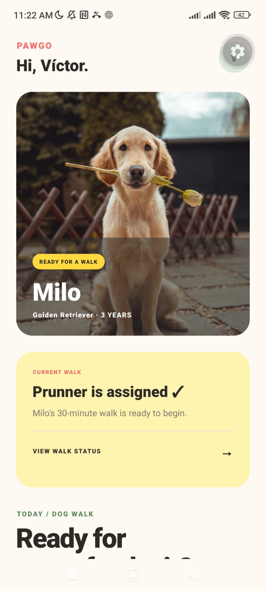
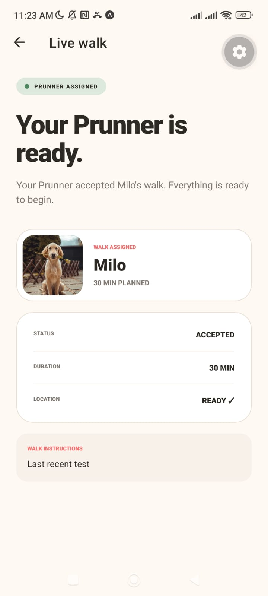
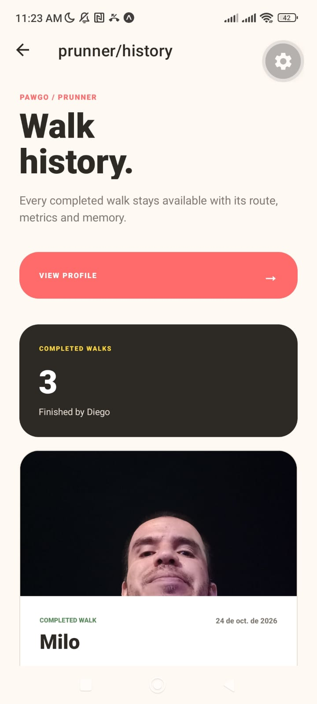
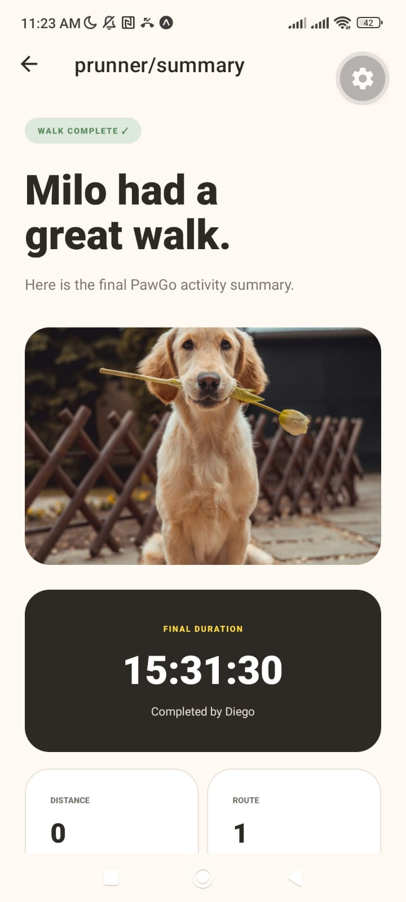

# PawGo 🐶

PawGo is a React Native mobile application that simulates the complete lifecycle of a dog-walking service.

The project was built as a hands-on React Native learning lab and as a bridge toward a production-ready application called PRUN.

It focuses on mobile-specific concepts such as GPS tracking, permissions, local persistence, media handling, navigation and role-based user flows.

## Overview

PawGo connects two demo roles:

- **Prowner** — the dog owner who requests and monitors a walk.
- **Prunner** — the dog walker who accepts, performs and completes the walk.

The application runs as a single-device demo while preserving a realistic separation between both roles.

## Main Flow

    Prowner
      ↓
    Create walk request
      ↓
    Capture pickup location
      ↓
    Prunner accepts request
      ↓
    Start walk
      ↓
    Foreground GPS tracking
      ↓
    Route + distance + timer
      ↓
    Prowner monitors progress
      ↓
    Prunner completes walk
      ↓
    Photo + note
      ↓
    Prowner reviews summary
      ↓
    1–5 star rating
      ↓
    History + profile statistics

## Features

### Prowner

- Create a dog-walking request.
- Select planned walk duration.
- Add instructions for the walker.
- Capture the pickup GPS location.
- Monitor accepted and active walks.
- View elapsed time, distance and route progress.
- Review the completed walk.
- View the Prunner's photo and note.
- Rate completed walks from 1 to 5 stars.
- Browse walk history.
- View profile activity statistics.

### Prunner

- Browse available walking requests.
- Review request details.
- Accept a walk.
- Start an assigned walk.
- Track the route using foreground GPS.
- Persist GPS points locally.
- Calculate traveled distance.
- Display average speed and pace.
- Resume an active walk after closing the app.
- Complete the walk.
- Attach a photo from the device gallery.
- Leave a walk summary note.
- Browse completed walk history.
- View profile activity and received ratings.

## Mobile Concepts Practiced

PawGo intentionally focuses on concepts that differ from a traditional React web application:

- Expo Router navigation.
- Mobile permissions.
- Foreground GPS tracking.
- Location subscriptions and cleanup.
- Device media library access.
- Local file persistence.
- AsyncStorage.
- Mobile application lifecycle.
- Safe areas.
- Persisted sessions.
- Persisted domain state.
- Route restoration.
- Role-based mobile flows.

## Architecture

The project separates UI, domain features, services, storage and shared utilities.

    src/
    ├── app/
    │   ├── prowner/
    │   ├── prunner/
    │   ├── login.tsx
    │   ├── profile.tsx
    │   └── _layout.tsx
    ├── components/
    ├── features/
    │   ├── auth/
    │   ├── dogs/
    │   └── walks/
    ├── services/
    ├── storage/
    ├── theme/
    ├── types/
    └── utils/

The walk flow follows a simple separation of responsibilities:

    Screen
      ↓
    Feature / domain logic
      ↓
    Repository
      ↓
    AsyncStorage

Device-specific operations such as GPS and image selection are isolated behind services.

## Walk State Machine

    requested
        ↓
    accepted
        ↓
    in_progress
        ↓
    completed

Each transition persists its associated data.

A completed walk can contain:

- assigned Prowner and Prunner;
- requested, accepted, started and completed timestamps;
- pickup coordinates;
- GPS route;
- traveled distance;
- final duration;
- average speed;
- average pace;
- Prunner note;
- walk photo;
- Prowner rating.

## GPS Tracking

PawGo uses `expo-location` for foreground location tracking.

During an active walk the application:

1. requests foreground location permission;
2. subscribes to GPS updates;
3. converts updates into persisted route points;
4. filters very small movements and unrealistic GPS jumps;
5. calculates traveled distance using the Haversine formula;
6. restores the active walk from local storage if the application is reopened.

The project intentionally uses **foreground tracking only**.

Background location tracking is outside the scope of this learning version.

## Local Persistence

PawGo currently uses:

- `@react-native-async-storage/async-storage` for session and walk data;
- `expo-file-system` for persistent walk photos.

This allows active and completed walks to survive normal application restarts without requiring a backend.

A production implementation would replace the local repository with a remote API and real-time data synchronization.

## Demo Users

### Prowner

    Name: Víctor
    Email: owner@pawgo.demo

### Prunner

    Name: Diego
    Email: walker@pawgo.demo

The role switcher exists only to demonstrate the complete two-sided flow on one device.

## Tech Stack

| Technology | Version |
| --- | --- |
| Node.js | 22.19.0 |
| Expo | 57.0.31 |
| React Native | 0.86.3 |
| React | 19.2.3 |
| TypeScript | 6.0.3 |
| Expo Router | 57.0.29 |
| AsyncStorage | 2.2.0 |
| Expo Location | 57.0.22 |
| Expo Image Picker | 57.0.20 |
| Expo File System | 57.0.7 |
| React Native Safe Area Context | 5.7.0 |

The project also uses Expo's React Compiler integration and typed routes.

## Running Locally

### Requirements

- Node.js 22.19.0
- npm
- Expo Go compatible with Expo SDK 57
- Android device or compatible emulator

Install dependencies:

    npm install

Start Expo:

    npm start

or:

    npx expo start

Then open PawGo using Expo Go.

## Quality Checks

The final project was validated with:

    npx expo install --check
    npx tsc --noEmit
    npx expo-doctor@1.21.4
    npx expo export --platform android

Final validation results:

    Expo dependencies: compatible
    TypeScript: 0 errors
    Expo Doctor: 21/21 checks passed
    Android Metro bundle: generated successfully

## Design

PawGo uses a warm pet-care visual identity built around:

- cream backgrounds;
- coral accents;
- natural green;
- soft yellow;
- rounded cards;
- high-contrast typography;
- Milo, a Golden Retriever, as the demo protagonist.

The interface was designed specifically for the project rather than relying on the default Expo starter UI.

## Screenshots

### Prowner Home

### Prunner Active Walk

### Walk Summary

### Walk History

## Project Status

PawGo currently includes the complete planned learning flow:

- authentication demo;
- role switching;
- request creation;
- foreground location;
- route tracking;
- distance metrics;
- active-walk recovery;
- live Prowner monitoring;
- walk completion;
- photo and note persistence;
- ratings;
- histories;
- profiles.

The remaining release work focuses on portfolio presentation, repository cleanup and Android APK generation.

## Road to PRUN

PawGo is intentionally local-first and backend-free.

Its purpose is to validate the mobile architecture and React Native concepts that will later be applied to **PRUN**, where the equivalent flows can evolve toward:

- real authentication;
- backend APIs;
- database persistence;
- multiple users and dogs;
- real-time synchronization;
- background location;
- maps;
- notifications;
- production security;
- Play Store deployment.

---

Built with React Native + Expo as a practical mobile engineering lab.
